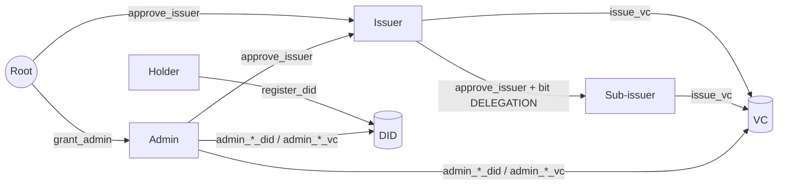

# vnu-trust/contracts

Hợp đồng Move của **VNU-Trust**: danh tính tự chủ (DID) và văn bằng khả kiểm (VC)
của ĐHQGHN trên Movement testnet.

| Mục | Giá trị |
|---|---|
| Gói đang dùng | `0x0ede7f6b38caab7ddfe757765fddbf07221f8b776c6395562faae571250708e3` |
| Root | chính địa chỉ publish (xem [Ai là root](#ai-là-root)) |
| Fullnode | `https://testnet.movementnetwork.xyz/v1` · chain id **250** |
| Nguồn sự thật cho địa chỉ | `../chain.env` — README này chỉ để tham khảo |
| Chính sách nâng cấp | `compatible` (mặc định) |
| Lần nâng cấp gần nhất | 13/11/2026, `upgrade_number` 1, tx `0x9c14fd7c…`, **không kèm mã nguồn** (`--included-artifacts none`) |

> Gói cũ `0x4a66666f…c6207` (publish theo kiểu **object**, `root_admin=tester`) đã
> bị bỏ. Đừng dùng các lệnh `create-object-and-publish-package` /
> `upgrade-object-package` của README cũ.

## Cấu trúc

```
sources/
  authority.move      root → admin → issuer, uỷ quyền sub-issuer, chuyển root 2 bước
  did_registry.move   đăng ký / cập nhật / tạm ngưng / thu hồi DID
  vc_registry.move    cấp / tạm ngưng / kích hoạt lại / thu hồi VC, hết hạn tính lúc đọc
  utils/constants.move  bit loại văn bằng, lý do thu hồi
  utils/errors.move     toàn bộ mã abort
tests/
  helpers/test_utils.move   fixture: setup(), user(), admin(), issuer(), delegator(), sub_issuer(), issue()
  did_registry_test.move    đặc tả vòng đời DID
  authority_test.move       đặc tả cây quyền, chuyển root, nâng cấp
  vc_registry_test.move     đặc tả vòng đời VC
  audit_findings_test.move  kịch bản tấn công F-xx / M-xx / R-xx, PASS = lỗ hổng đã đóng
```

Mỗi test là **một luật**, đặt tên `<hàm>_<điều kiện>`. Test abort kiểm đúng **mã lỗi
và module** nơi abort xảy ra (`location = …`), để không PASS nhầm vì một phép kiểm
khác chặn trước.

Phụ thuộc giữa các module: `vc_registry` → `authority` → `did_registry`.



Muốn làm bất cứ việc gì cũng phải có **DID đang hoạt động**. Riêng root được miễn.

### Bất biến

1. Mỗi địa chỉ giữ **tối đa một** vai trò: root, admin còn sống, hoặc issuer còn sống
   ("còn sống" = chưa bị thu hồi, kể cả đang tạm ngưng).
2. Mọi vai trò trừ root chỉ dùng được khi DID của địa chỉ đang ACTIVE.
3. Sub-issuer chỉ hợp lệ khi **bản ghi** issuer đã cấp nó còn hợp lệ. Cha bị tạm
   ngưng, thu hồi, hết hạn, hoặc được cấp lại thành bản ghi mới thì con mất quyền.
4. `admin_revoke_did` thu hồi luôn vai trò của địa chỉ đó; đăng ký DID mới không
   làm vai trò sống lại.
5. Cấp lại sau thu hồi tạo bản ghi mới (`version + 1`), bản ghi cũ giữ làm vết.
6. Issuer tự tạm ngưng / thu hồi VC **của mình** khi DID còn ACTIVE và vai trò chưa
   bị tạm ngưng / thu hồi. Hết hạn uỷ quyền vẫn thu hồi được.
7. Mỗi VC mang **đúng một** bit loại văn bằng. Hết hạn được tính lúc đọc và lấn cả
   trạng thái tạm ngưng; chỉ REVOKED đứng trên nó.

## Loại văn bằng (`vc_type_mask`)

| Bit | Giá trị | Loại |
|---|---|---|
| 0 | 1 | Cử nhân |
| 1 | 2 | Thạc sĩ |
| 2 | 4 | Tiến sĩ |
| 3 | 8 | Bảng điểm |
| 4 | 16 | Chứng chỉ vi mô |
| 5 | 32 | Uỷ quyền — **chỉ root cấp được** |

`approve_issuer` đòi mask khác 0 và chỉ gồm 6 bit trên. `issue_vc` đòi `vc_type`
là **đúng một** bit và bit đó nằm trong mask của issuer.

Chuỗi DID: `did:vnu:` + phần giữa tuỳ ý + địa chỉ chủ (`0x` + 64 hex thường), tối đa 128 byte.

## Kiểm thử

```bash
aptos move test --skip-fetch-latest-git-deps      # aptos 7.x
movement move test --skip-fetch-latest-git-deps   # Movement CLI (lõi aptos 3.5)
```

⚠️ Movement CLI dùng trình biên dịch cũ, **từ chối mọi ký tự ngoài ASCII, kể cả
trong chú thích** (`E01001 invalid character`). `aptos` 7.x thì chấp nhận nên
lỗi chỉ lộ ra ở `movement`. Viết chú thích tiếng Việt **không dấu**. Kiểm nhanh:

```bash
grep -rnP '[^\x00-\x7F]' sources tests || echo "ASCII sạch"
```

Kiểm tên hàm giữa hợp đồng, hai backend và giao diện:

```bash
node ../scripts/abi-check.mjs
```

## Publish

Dùng script. Đừng gõ lệnh tay:

```bash
cd ~/KLTN/vnu-trust
./scripts/deploy.sh --init                 # lần đầu: tạo profile "vnu-trust" rồi publish
./scripts/deploy.sh --profile <tên>        # dùng profile có sẵn
```

Script làm những việc sau:

1. Giữ khoá ở `~/.vnu-trust-deployer/.aptos/config.yaml` (quyền 600). Script **từ chối** chạy nếu thư mục này nằm trong một repo git.
2. In địa chỉ sẽ thành root rồi bắt nhập chữ `publish` để xác nhận.
3. Gọi faucet nếu số dư dưới 0,5 MOVE.
4. Chạy `aptos move publish --named-addresses vnu=<addr>,root_admin=0x0 --included-artifacts none`.
5. Ghi `CONTRACT_ADDRESS` vào `chain.env` rồi gọi `sync-chain-env.sh`.

Sau khi publish:

1. Đặt `VERIFY_ONCHAIN=true` ở `backend/.env` và `backend-go/.env`.
2. Khởi động lại: `./scripts/dev.sh down && ./scripts/dev.sh up`.
3. Chạy `node frontend/scripts/chain-probe.mjs` rồi `./scripts/dev.sh test`.

### Ai là root

`Move.toml` để `root_admin = "_"`. Khi publish với `root_admin=0x0`, `init_module`
lấy **chính người publish** làm root (bản sửa F-00). Hệ quả: **khoá của profile
publish là khoá root của toàn hệ thống.** Đổi root thì dùng `propose_root` →
`accept_root`; người nhận phải tự ký.

### Nâng cấp

Gói publish vào **tài khoản**, chính sách `compatible`. Nâng cấp tức là publish lại
**cùng địa chỉ, cùng profile**:

```bash
cd <thư mục chứa .movement/config.yaml của tài khoản publish>
movement move publish --package-dir ~/KLTN/vnu-trust/contracts --profile <profile> \
  --named-addresses vnu=<CONTRACT_ADDRESS>,root_admin=0x0 \
  --included-artifacts none --skip-fetch-latest-git-deps
```

Dùng **Movement CLI** (bytecode v6, đúng loại đang chạy trên chuỗi). Nên mô phỏng
trước: `build-publish-payload` rồi `POST /transactions/simulate` với chữ ký toàn số 0.

`--included-artifacts none` chỉ đưa **bytecode** lên chuỗi, không kèm mã nguồn và
source map. Bytecode vẫn công khai và dịch ngược được; mã nguồn của các phiên bản
đã publish trước đó vẫn đọc được trong lịch sử giao dịch.

- Chỉ được **thêm** hàm, struct hoặc module. Không được đổi trường của struct đã có, chữ ký hàm `public`/`entry` đã có, hay `has key`/`store`.
- `init_module` **không chạy lại** khi nâng cấp. Resource mới phải có một entry khởi tạo riêng, chạy một lần.
  Bản nâng cấp 13/11/2026 thêm `DelegationRegistry`; ngay sau khi nâng cấp phải gọi
  `authority::init_delegation_registry` bằng tài khoản publish. Trước khi gọi, mọi
  luồng chạy bình thường trừ việc cấp sub-issuer qua uỷ quyền.
- Muốn đặt lại root, hoặc đổi bố cục storage, thì phải publish ở **địa chỉ mới**. Dữ liệu ở địa chỉ cũ bị bỏ lại.

## Gas

```bash
curl -X POST "https://faucet.testnet.movementnetwork.xyz/mint?amount=200000000&address=<addr>"
```

Người dùng giao diện bấm "Nhận token thử nghiệm" ở trang "Danh tính & gas".

## Mã abort

Mã nằm trong `vm_status` dưới dạng hex, ví dụ `0x3e9` = 1001.

| Nhóm | Mã | Hay gặp |
|---|---|---|
| Authority | 1001–1021 | 1001 không phải root · 1010 không phải admin đang hoạt động · 1012 hết hạn uỷ quyền · 1013 loại văn bằng vượt quyền · 1016 xung đột vai trò · 1018 đích được bảo vệ · 1019 issuer cha không còn hợp lệ · 1020 mask / loại văn bằng sai · 1021 đề cử root sai |
| Identity | 2001–2012 | 2003 DID không hoạt động · 2007 địa chỉ đã có DID · 2008 CID sai · 2011 chuỗi DID không gắn với địa chỉ · 2012 chủ tự khoá |
| Credential | 3001–3010 | 3004 đã thu hồi · 3005 đã hết hạn · 3009 VC đã tồn tại · 3010 tự cấp cho mình |
| Utils | 4001–4006 | 4001 hash không đủ 32 byte · 4005 kết quả quá lớn, dùng `*_paginated` · 4006 đã khởi tạo |

Danh sách đầy đủ ở `sources/utils/errors.move`.

## Tài liệu liên quan

- `../docs/CONTRACT_AUDIT.md`: F-00…F-12, đã sửa.
- `../docs/SECURITY_REVIEW.md`: M-01…M-09, còn chờ quyết định.
- `../docs/CONTRACT_REVIEW.md`: rà soát 13/11/2026 (R-01…R-10, C-01…C-08) và thứ tự sửa đề xuất.

⚠️ Không commit bất kỳ tệp `.aptos/` hay `.movement/` nào. Tệp đó chứa khoá riêng,
và khoá của địa chỉ publish chính là khoá root.
